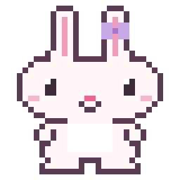
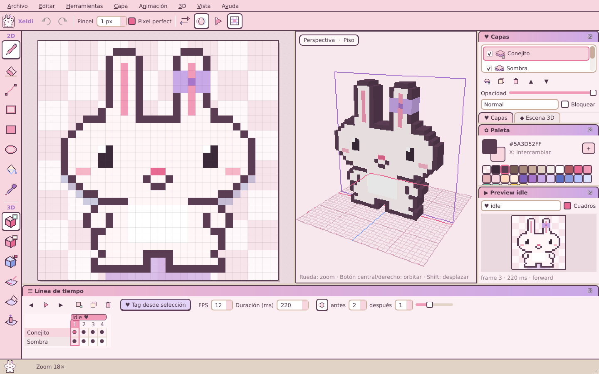

<p align="center">
  
</p>

<h1 align="center">Xeldi</h1>

<p align="center"><b>Editor de pixel art 2D con construcción 3D en vóxeles</b><br>
capas · onion skin · línea de tiempo con tags · preview idle en bucle · planos de trabajo 3D estilo Mental Canvas</p>



Xeldi junta el flujo de un editor de sprites (capas, frames, onion skin, tags de animación y una ventana
que reproduce el *idle* en bucle mientras editas otro frame) con un espacio 3D donde **1 unidad = 1 vóxel = 1 pixel**:
dibujas sobre planos de trabajo flotantes, los extruyes a vóxeles, esculpes bloque por bloque y vuelves a
proyectar el modelo a un sprite. Es software nativo para Linux (Ubuntu y Arch), escrito en C++20 + Qt 6.

## Qué puedes hacer hoy (v0.1)

**2D**
- Lápiz con *pixel perfect*, borrador, línea, rectángulo (vacío/relleno), elipse, bote de pintura y cuentagotas; pinceles cuadrados de 1 a 64 px. Clic derecho pinta con el color secundario.
- Capas con visibilidad, bloqueo, opacidad y modos de fusión (normal, multiplicar, trama, sumar, oscurecer, aclarar, superponer).
- Frames con duración propia, FPS del documento, duplicar/eliminar.
- **Tags de animación** (`idle`, `walk`…) con bucle hacia adelante, reversa o ping-pong y FPS propio.
- **Onion skin** con frames anteriores (rosa) y siguientes (azul), opacidad decreciente y vuelta dentro del tag.
- **Preview idle**: panel que reproduce el tag elegido en bucle a su velocidad real mientras editas.
- Reproducir en el lienzo principal (Enter), zoom con la rueda, desplazamiento con botón central o espacio, pellizco táctil.
- Paleta pastel editable; importar PNG; exportar frame PNG y **hoja de sprites + JSON**.

**3D**
- Rejilla de vóxeles **dispersa en chunks de 16³** (solo se guarda lo que existe).
- **Planos de trabajo** frontales, laterales y superiores; moverlos a lo largo de su normal; dibujar pixeles sobre ellos desde la vista 3D.
- Herramientas: colocar, borrar y pintar vóxeles; dibujar/borrar en plano; cuentagotas 3D.
- **Extruir plano a vóxeles** (con relleno Bresenham 3D para planos inclinados).
- **Proyectar a sprite**: frente, atrás, lados o arriba, 1 vóxel = 1 pixel, a una capa nueva.
- **Generar desde vistas**: dibuja frente, lado y arriba en tres frames y Xeldi reconstruye el objeto en vóxeles (casco visual con color por cara).
- Cámara estilo Blender: orbitar (botón central o derecho, o Alt+clic), desplazar (Shift), zoom (rueda), vistas 1/3/7/9 y perspectiva/ortográfica (5).
- Exportar a **OBJ + MTL**.

**Todo** se puede deshacer/rehacer, y todo se guarda en el formato nativo **`.xeldi`** ([especificación](docs/FORMATO.md)).

## Instalar

### Ubuntu / Debian (.deb)

```bash
sudo apt install build-essential cmake ninja-build qt6-base-dev nlohmann-json3-dev zlib1g-dev dpkg-dev
./packaging/build-deb.sh
sudo apt install ./build-deb/xeldi_*.deb
```

Probado en Ubuntu 24.04. Compila el `.deb` en la misma versión de Ubuntu donde lo vas a instalar (los nombres
de las librerías de Qt cambian entre versiones). El CI de GitHub también deja un `.deb` para Ubuntu 24.04 en
cada commit (pestaña *Actions* → artefactos).

### Arch Linux (PKGBUILD)

```bash
cd packaging/arch
makepkg -si
```

### Compilar a mano

```bash
cmake -S . -B build -G Ninja -DCMAKE_BUILD_TYPE=Release
cmake --build build
ctest --test-dir build --output-on-failure
./build/src/app/xeldi                    # abre el ejemplo del conejito
./build/src/app/xeldi mi_sprite.xeldi    # abre un proyecto
```

Dependencias: CMake ≥ 3.22, compilador C++20 (GCC 11+ / Clang 14+), Qt 6.2+ (Widgets), zlib y nlohmann-json.
No necesita OpenGL: el viewport 3D usa un rasterizador por software del motor, así que funciona igual en X11, Wayland y máquinas virtuales.

## Atajos

| Acción | Atajo | Acción | Atajo |
|---|---|---|---|
| Lápiz / Borrador | `B` / `E` | Deshacer / Rehacer | `Ctrl+Z` / `Ctrl+Shift+Z`, `Ctrl+Y` |
| Línea / Rectángulo / Relleno | `L` / `U` / `Shift+U` | Frame anterior / siguiente | `,` / `.` |
| Elipse / Bote / Cuentagotas | `C` / `G` / `I` | Nuevo / duplicar frame | `Alt+N` / `Alt+D` |
| Pincel − / + | `[` / `]` | Reproducir | `Enter` |
| Intercambiar colores | `X` | Onion skin | `F3` |
| Colocar / borrar vóxel | `V` / `Shift+V` | Nueva capa | `Shift+N` |
| Pintar vóxel | `P` | Plano anterior / siguiente | `RePág` / `AvPág` |
| Dibujar / borrar en plano | `D` / `Shift+D` | Mover plano ±1 | `Alt+↑` / `Alt+↓` |
| Extruir plano | `Ctrl+E` | Vistas frente / lado / arriba / iso | `1` / `3` / `7` / `9` |
| Perspectiva ↔ ortográfica | `5` | Cuadrícula de pixeles | `Ctrl+'` |

## Arquitectura

```
src/
├── core/       Modelo de datos: Document, Layer, Timeline, Palette, VoxelGrid, Workplane,
│               comandos deshacibles (Command/History) y acciones con nombre (ActionRegistry)
├── engine2d/   Composición de capas, pinceles pixel-perfect, onion skin, reproductor de animación
├── engine3d/   Cámara, picking DDA, rasterizador por software, extrusión, proyección, generar desde vistas
├── io/         Formato .xeldi, PNG, OBJ, hoja de sprites
├── editor/     Editor: estado de edición + historial + acciones (la fachada que usa cualquier UI)
└── app/        Interfaz Qt 6 de escritorio (lo único que depende de Qt)
```

`core`, `engine2d`, `engine3d`, `io` y `editor` **no dependen de Qt**: es la base pensada para llevar Xeldi a
tablets con otra interfaz. Toda acción (deshacer, cambiar de plano, onion skin, reproducir…) pasa por acciones
con nombre como `edit.undo` o `plane.next`, así que una UI táctil solo tiene que conectar gestos a esos nombres.
La entrada de puntero (`PointerInput`) ya trae presión y botón primario/secundario. Más detalle en
[docs/ARQUITECTURA.md](docs/ARQUITECTURA.md).

## Hoja de ruta

- Generar desde vistas **isométricas** (hoy usa vistas ortográficas frente/lado/arriba).
- Animación 3D: vóxeles por frame/tag (el formato ya reserva `frame_index` por chunk).
- Planos de trabajo inclinados desde la UI (el motor ya los soporta) y rotación libre del plano.
- Backend OpenGL/Vulkan opcional para escenas grandes.
- Selección y transformaciones (mover, rotar, espejo), capas de grupo, cels enlazadas.
- Exportar GIF y glTF; importar hojas de sprites.
- Paletas (.gpl/.hex), atajos configurables, compresión Zstandard opcional en `.xeldi`.
- Interfaz táctil para tablets (Linux táctil primero; Android/iPadOS después).

## Licencia

MIT. El arte (conejito, iconos) es original de este proyecto y se genera con `tools/gen_assets.py`.
